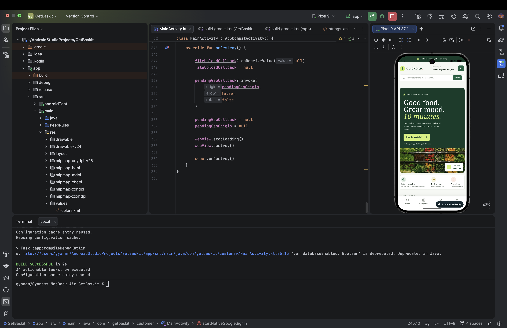

# Baskit Android

### Your everyday essentials, delivered.

A native Android application for the Baskit online shopping platform, built using Kotlin and Android WebView.

---

## App Preview



---

## About

Baskit Android brings the Baskit shopping experience to Android devices by combining the existing web platform with native Android capabilities.

The application uses Android WebView to load the live Baskit website while supporting native functionality such as Google Sign-In, file uploads, location access, and Android navigation.

- **Live Website:** https://getbaskit.netlify.app/
- **GitHub Repository:** https://github.com/redux-next/baskit-android

---

## Features

- **WebView Integration** – Access the Baskit shopping platform directly from the Android application.
- **Native Google Sign-In** – Google authentication using Android Credential Manager and Firebase Authentication.
- **Persistent Authentication** – Remain signed in between application launches.
- **Custom Loading Screen** – Loading indicator displayed while the website initializes.
- **File Upload Support** – Select and upload files through the Android application.
- **Location Access** – Supports Android location permissions and browser geolocation.
- **Navigation Support** – Android back-button handling within WebView.
- **Secure Connection** – Connects to the live Baskit website over HTTPS.

---

## Screenshots

The application preview is available above.

---

## Tech Stack

| Technology | Purpose |
|---|---|
| Kotlin | Native Android development |
| Android Studio | Development environment |
| Android WebView | Web application integration |
| Firebase Authentication | User authentication |
| Google Credential Manager | Native Google Sign-In |
| Gradle | Build automation |
| XML | Android layouts and resources |
| Next.js | Web platform |

---

## Application Details

| Property | Value |
|---|---|
| Application Name | Baskit |
| Package Name | `com.getbaskit.customer` |
| Platform | Android |
| Programming Language | Kotlin |
| Architecture | WebView-based Android application |
| Authentication | Firebase Authentication |
| Google Sign-In | Android Credential Manager |
| Website | https://getbaskit.netlify.app/ |

---

## Getting Started

### Prerequisites

Before running the project, make sure you have:

- Android Studio
- Android SDK
- JDK compatible with the project's Gradle configuration
- An Android device or emulator
- Internet connection

### Installation

1. Clone the repository:

   ```bash
   git clone https://github.com/redux-next/baskit-android.git
   ```

2. Open the project in Android Studio.

3. Allow Gradle to sync.

4. Connect an Android device or start an emulator.

5. Click **Run** in Android Studio.

---

## Build APK

### Debug APK

Run:

```bash
./gradlew assembleDebug
```

### Release APK

Run:

```bash
./gradlew assembleRelease
```

Generated APK files can be found in:

```text
app/build/outputs/apk/
```

**Note:** Release builds may require signing configuration before distribution.

---

## Project Structure

```text
Baskit-Android/
│
├── app/
│   ├── src/
│   │   └── main/
│   │       ├── java/
│   │       │   └── com/getbaskit/customer/
│   │       │       └── MainActivity.kt
│   │       │
│   │       ├── res/
│   │       │   ├── drawable/
│   │       │   ├── layout/
│   │       │   └── values/
│   │       │
│   │       └── AndroidManifest.xml
│   │
│   └── build.gradle.kts
│
├── gradle/
│   └── libs.versions.toml
│
├── build.gradle.kts
├── settings.gradle.kts
├── gradle.properties
├── gradlew
├── gradlew.bat
├── .gitignore
└── README.md
```

---

## Security

- Never commit Android signing keys or keystore passwords.
- Keep private credentials and local configuration out of version control.
- Use HTTPS for network communication.
- Request Android permissions only when required.
- Keep Firebase configuration and authentication settings secure.

---

## Developer

**GYANAM**

- GitHub: https://github.com/redux-next
- LinkedIn: https://www.linkedin.com/in/gyanam-gogoi-0b9ab720a/

---

### Built with Kotlin and Firebase.
